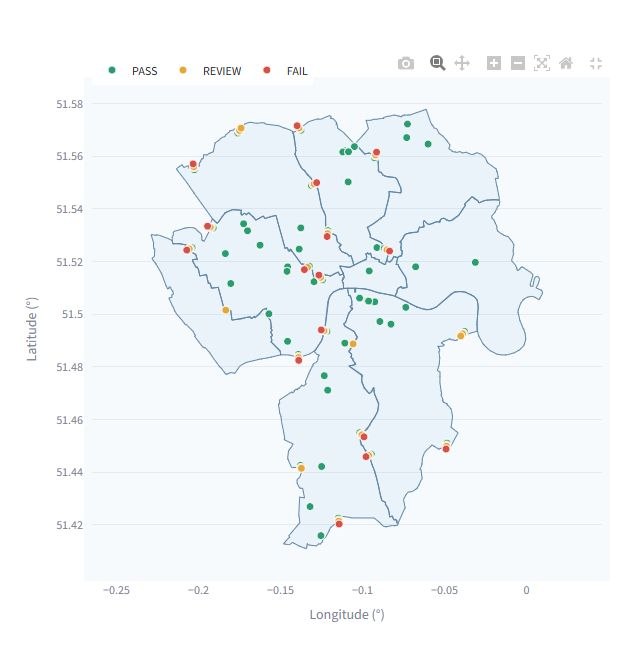
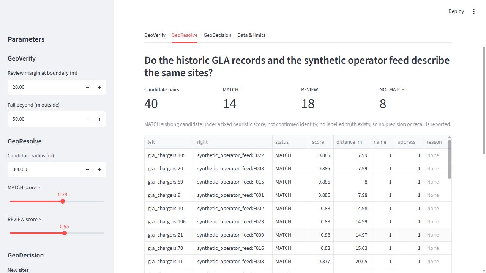
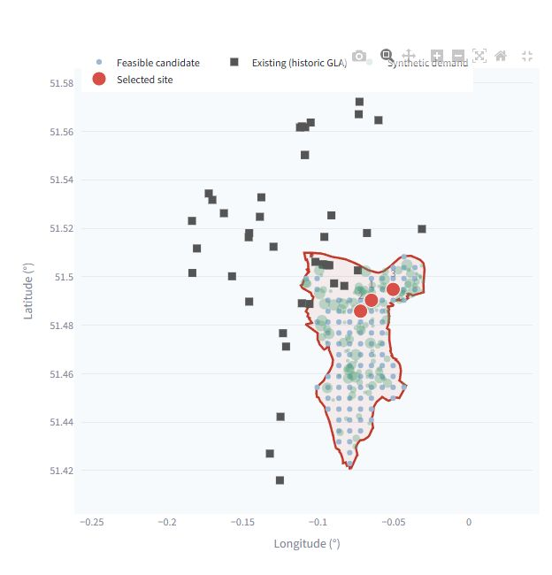

# GeoPilot

GeoPilot v1.0 is a small, offline-capable Python toolkit that answers three practical questions about
geospatial records:

1. **GeoVerify** – does a point really sit inside the zone its record claims?
2. **GeoResolve** – do records from two sources describe the same place?
3. **GeoDecision** – given demand points and existing sites, which grid locations are the best screening
   candidates for new sites under explicit distance constraints?

It exists because location data from different systems is routinely inconsistent: wrong region labels,
duplicated sites, ad-hoc coordinate systems and opaque "best site" scores. GeoPilot keeps every step explicit:
projected metric distances, named reason codes, conservative statuses, and limitation statements next to
every result.

## Live Demo

**<https://geopilot-gis.streamlit.app/>** – the integrated app hosted on Streamlit Community Cloud, running on
the bundled sample data. The page opens in Simplified Chinese; use the sidebar language selector
(语言 / Language) to switch to English. It is a demonstration on historic open data and synthetic inputs, not a
statement about current London charging provision. The app may take a moment to wake up if it has been idle.

> **Scope.** v1.0 is a deterministic, rule-based library with a demo app. It contains **no LLM or autonomous
> agent**, performs **no live data access**, and makes **no claim of accuracy, current charger availability or
> real-site feasibility**. The bundled London data is partly historic open data and partly synthetic; see
> [Limitations](#london-sample-data-and-limitations).

## Capabilities

| Module | Input | Output |
| --- | --- | --- |
| `geopilot.verify` | Points, claimed zone ids, zone polygons | `PASS` / `REVIEW` / `FAIL` / `UNRESOLVED` per record, signed metric distance to the claimed boundary, reason code |
| `geopilot.verify.assign_zones` | Points, zone polygons (no claims) | Every covering zone per point (`INSIDE` / `BOUNDARY`) and `ASSIGNED` / `MULTIPLE_MATCHES` / `ON_BOUNDARY` / `OUTSIDE_ALL_ZONES` / `NO_COORDINATE` ([docs](docs/zone_assignment.md)) |
| `geopilot.decision.plan_coverage` | Any point data plus an explicit role mapping | Weighted-demand coverage screening with a per-record audit ([docs](docs/decision_roles.md)) |
| `geopilot.workspace` | Uploaded CSV / GeoJSON bytes, field mapping, confirmed EPSG CRS | Per-row LOADED/REJECTED quality report, zones, assignment run, coverage run on uploads, CSV/JSON exports |
| `geopilot.coverage_examples` | Bundled OSM facilities (ODbL), synthetic demand, Southwark | EV-charging and public-toilet coverage examples through the same `plan_coverage` ([docs](docs/coverage_examples.md)) |
| `geopilot.resolve` | Points/records from several sources | Scored candidate pairs (`MATCH` / `REVIEW` / `NO_MATCH`), feature breakdown, conservative clusters with provenance |
| `geopilot.decision` | Zone polygon, existing stations, demand/context points | Feasible grid candidates with component scores, greedily selected sites, existing vs incremental coverage |
| `geopilot.tools` | lon/lat, polygons | Geodesic distance, signed point-in-polygon, metric buffer, nearest point, CRS transform |
| `geopilot.data` | CSV / GeoJSON (optionally in another CRS) | Validated `Entity` / `Zone` records with all failures reported together |

Results can be exported as JSON and CSV from the CLI demo and the app.

## Technology stack

Python ≥ 3.12 · shapely 2 · pyproj · pydantic 2 · RapidFuzz · Streamlit + Plotly (demo app) · pytest.

## Repository structure

```
src/geopilot/
  data/       schema, CSV/GeoJSON loaders, CRS conversion, quality checks
  verify/     GeoVerify
  resolve/    GeoResolve
  decision/   GeoDecision
  tools/      reusable GIS operations
  scenario.py bundled London sample loader and one-call runners
  workspace.py custom-upload workflow (bytes -> mapped entities/zones -> assignment/coverage -> exports)
  coverage_examples.py EV-charging / public-toilet coverage examples (one shared method)
  reporting.py JSON/CSV export
app/streamlit_app.py      integrated offline demo (London sample, custom workspace, coverage examples)
app/custom_workspace.py   custom-data upload page
app/coverage_ui.py        coverage examples page and coverage on uploaded data
examples/data/coverage/   OpenStreetMap facility records (ODbL 1.0, separate database) + manifest
.streamlit/config.toml    5 MB upload cap
docs/                     API notes (decision roles, zone assignment) and screenshots
examples/run_demo.py      standalone CLI demo (--module verify|resolve|decision|all)
examples/data/london/     bundled sample data + manifest.json
scripts/prepare_data.py   deterministic data preparation
tests/                    pytest suite
docs/screenshots/         application screenshots
DATA_SOURCES.md           sources, licences, attribution
```

## Installation

Linux / macOS (POSIX shell):

```bash
python -m venv .venv
source .venv/bin/activate
pip install -r requirements.txt      # pinned versions used for development and CI
pip install -e . --no-deps
```

Windows PowerShell (calls the virtual environment's Python explicitly, so no activation script or
execution-policy change is needed):

```powershell
python -m venv .venv
.venv/Scripts/python.exe -m pip install -r requirements.txt
.venv/Scripts/python.exe -m pip install -e . --no-deps
.venv/Scripts/python.exe -m pytest -q
.venv/Scripts/python.exe examples/run_demo.py --module all
.venv/Scripts/python.exe -m streamlit run app/streamlit_app.py
```

`requirements.txt` ends its header with an editable `-e .` entry, so installing it from the repository root
already installs the local `geopilot` package (this is what hosted deployments that read only that file
rely on); the separate `pip install -e . --no-deps` step above is therefore harmless and optional.

`pip install -e ".[app,test]"` also works if you prefer unpinned compatible ranges.

## Run the sample demo (offline)

```bash
python examples/run_demo.py --module all
python examples/run_demo.py --module verify   --export-dir out --format csv
python examples/run_demo.py --module resolve  --match-score 0.85 --export-dir out
python examples/run_demo.py --module decision --target-count 5 --service-radius-m 1200 --export-dir out
```

`--format` is `json`, `csv` or `both`. Run `--help` for every parameter. Invalid parameters exit with
status 2 and a message.

Streamlit app (no network or map tiles needed):

```bash
streamlit run app/streamlit_app.py
```

The page is in Simplified Chinese by default; the sidebar language selector (语言 / Language) switches to
English without resetting parameters. Only display text is translated; exported files, field names and all
numerical results are identical in both languages.

The sidebar exposes the GeoVerify margins, the GeoResolve candidate radius and score thresholds, and the
GeoDecision parameters and score weights. The CLI flags are listed by `python examples/run_demo.py --help`
and are a different, smaller set (for example, no candidate-radius or weight flags).
The **GeoVerify** and **GeoDecision** tabs show a plain lon/lat map plus metrics and tables; the **GeoResolve**
tab shows metrics, a scored-pair table and a cluster table, with no map. Each of the three analysis tabs has
JSON and CSV download buttons. A fourth tab summarises data sources and limits. Source data is read from
`examples/data/london` of a checkout; set `GEOPILOT_DATA_DIR` to use another folder with the same files.
If a GeoDecision parameter combination is refused (for example by the app's work limits), the error is shown
in that tab and the other tabs keep working.

### Custom data workspace (upload)

Choose **Custom data (upload)** under *Workspace* in the sidebar. The London sample is not computed on this
page.

1. Upload a point file (CSV, or GeoJSON with Point geometries) and enter a source label. For CSV, choose the
   x (longitude/easting) and y (latitude/northing) columns; GeoJSON uses each geometry. ID, name, address,
   category, claimed zone and demand weight are optional selectors. A field you do not map is absent; no
   column is picked automatically.
2. Enter the point CRS as `EPSG:<code>` and tick the confirmation box. The box starts unticked and must be
   ticked again whenever the code changes. GCJ-02 and BD-09 are refused by name: PyProj has no
   transformation for them, and none is guessed.
3. Upload a Polygon/MultiPolygon GeoJSON boundary layer, choose its zone ID (and optional name) property,
   enter a source label and confirm its CRS (independently of the points).
4. Click **Run spatial assignment** to see status metrics, a map (zone outlines including holes; points
   coloured by status, with the original ID and the zone names on hover) and a result table. You can
   download `assignment_results.csv` and `assignment_run.json` (digests, CRSs, mappings and quality counts).

Constraints:

* **Where uploads go.** Uploaded content passes through the Streamlit server running the app and is processed
  in that server's memory for your session; the app works only from those bytes and never reads a local path.
  GeoPilot does not intentionally write uploaded content to disk or to a shared cache, and does not record
  filenames; inputs are identified by SHA-256. The hosting environment (server logs, backups, network) is
  outside GeoPilot's control, so don't upload data you are not allowed to send to that server.
* **Size limits.** Each file is limited to 5 MB and 20,000 records. Boundary layers are limited to
  2,000 zones, 200,000 vertices per zone and 500,000 vertices in total. Point × zone pairs are limited to
  2 million. Each limit is checked before the work it guards.
* **File-level errors.** These refuse the whole file with a reason: a file that isn't UTF-8 (a BOM is
  accepted), blank or duplicate CSV headers, malformed quoting, and invalid JSON.
* **Row-level errors.** These reject the row with a reason; rejected rows stay in the CSV export as
  `REJECTED`. They include:
  * a row with the wrong number of fields
  * a non-numeric, one-sided, boolean or out-of-range coordinate
  * an unsupported geometry type
  * a duplicated ID: every copy of the ID is rejected
* **Missing values.** Rows with no coordinates are kept and reported as `NO_COORDINATE`. Rows with no ID get
  an explicitly marked temporary ID that never collides with an original ID, and the original value is kept
  separately.
* **Boundary layer.** Any unusable boundary feature refuses the layer, so a zone is never silently missing.
* **Stale results.** Changing a file, mapping, CRS or source label discards the previous result and its
  downloads. Results are kept only in your session's state on the server, not shared with other sessions.
* **Upload cap.** Each upload is capped at 5 MB in three places: the uploader widget, `.streamlit/config.toml`
  (`server.maxUploadSize`) and the parser. This prevents the server from buffering Streamlit's default of
  200 MB.
* **Strict JSON.** GeoJSON must be strict JSON: `NaN`, `Infinity` and numbers that overflow a float refuse the
  file.
* **CRS input.** CRSs are accepted only as `EPSG:<code>` for 2-D geographic or projected systems. WKT, PROJ
  strings and files are not accepted.

**Coverage on uploaded data** (step 4 of the same page) runs the same `plan_coverage` used by the examples:

1. **Study zone:** choose one of the uploaded zones.
2. **Roles:** give every category a role (existing facility, weighted demand, context or ignore). Roles start
   unmapped, and an unmapped category is refused with `UNMAPPED_ROLE`.
3. **Inputs:** set context metric names, the demand weight field and the scoring weights.
4. **Parameters:** set the radius, target, grid and minimum distances. The only method is
   `weighted_coverage`.
5. **No existing facilities:** if there are none, declare it explicitly.

Rejected rows and rows without coordinates must be explicitly acknowledged as excluded before the button is
enabled. Any change to an input, role, weight or parameter discards the previous coverage result.

### Coverage examples: EV charging stations vs public toilets

Choose **Coverage examples** under *Workspace*. Both examples call the same `plan_coverage` function and
weighted-coverage algorithm on the bundled Southwark boundary and synthetic demand. The only differences are
the facility category and a generic eligibility filter. Defaults: target 3, grid 500 m, radius 500 m,
minimum distance to existing facilities 250 m, minimum distance between new sites 600 m, demand-only weights.

| Example | Facilities used | Weighted demand coverage (defaults) |
| --- | --- | --- |
| EV charging stations (default) | All 63 saved OSM `charging_station` records, as tagged. This is not a statement of public availability: 5 are tagged `access=yes`, 4 carry known restrictions (2 `no`, 1 `customers`, 1 `taxi`) and 54 have no access tag. The app shows these counts | 37.6 % existing → 57.2 % with 3 new sites |
| EV charging stations (optional conservative access filter) | The 5 with `access=yes`/`permissive`. Known restrictions (`no`/`customers`/`taxi`/`private`/`permit`) are excluded, and so are the 54 without an access tag unless you opt in with a warning | 8.3 % existing → 30.5 % with 3 new sites |
| Public toilets | 28 of 100 OSM toilets with `access=yes`/`permissive`. 18 restricted and 54 with unknown access are excluded and audited; unknown access can be opted in with a warning | 15.7 % existing → 34.6 % with 3 new sites |

Caveats:

* **Demand:** demand is in synthetic demand units, not observed demand.
* **Facilities outside Southwark** (inside its bounding box) are kept, because they can cover demand inside
  the study area.
* **Not verified:** availability, opening hours, fees, indoor location and wheelchair access are not
  verified.
* **Licence:** the OSM file is a separate ODbL 1.0 database (© OpenStreetMap contributors); see
  `DATA_SOURCES.md`.
* **App limits:** the app uses stricter work limits than the library: 20,000 records or grid cells,
  50 sites, 2 million pairs and 5 million greedy evaluations. More expensive combinations are refused with
  `RESOURCE_LIMIT_EXCEEDED`.
* **Audit:** run `python examples/audit_coverage.py` to recheck both examples independently.

The London sample keeps its own 42 historic GLA records and original defaults.

## Run the tests

```bash
python -m pytest -q
```

The suite covers CRS and metric-distance arithmetic against analytic values, invalid geometry/ID/parameter
handling, status thresholds, resolution conflicts and determinism, exact coverage numbers, data-manifest
hashes, regeneration of the synthetic files, CLI exit codes, exports and a headless render of the app,
including real `AppTest` uploads through the custom workspace (errors, stale-result invalidation, isolated
sessions, map and downloads). The coverage examples are also checked independently: their coverage numbers
are recomputed with WGS 84 geodesic distances.

A separate, portable audit of both coverage examples runs offline and is also run in CI:

```bash
python examples/audit_coverage.py
```

It recomputes the following without using the screening internals or GeoPilot's spatial helpers:

* the candidate grid, using direct PyProj transformations
* coverage, scores, distance constraints and the greedy selection, using WGS 84 geodesic distances
* source preservation
* the charger and toilet access-tag counts and conservative eligibility

It checks arithmetic and provenance, not real facility availability or observed demand.

For the disclosed browser-upload gap, synthetic input files and exact manual expected results, see
[PR #1 acceptance and deployment handoff](docs/acceptance_pr1.md).

## Interpreting spatial outputs

* **Coordinates** are WGS 84 lon/lat (EPSG:4326). Other CRSs are converted on load via `input_crs`.
* **Distances** are straight-line metres: geodesic for point pairs, and a local azimuthal-equidistant
  projection centred on the analysis location for boundary and coverage tests. They are not travel distance
  or time.
* **GeoVerify `signed_distance_m`**: positive inside the claimed zone, negative outside; `0` on the boundary.
  Defaults: `REVIEW` within 20 m of the boundary, `FAIL` more than 50 m outside. These are review margins
  you choose, not measured coordinate error. `PASS` means *consistent with the supplied boundary*, not *true*.
  `OUTSIDE_ALL_SUPPLIED_ZONES` means the point is in none of the zones provided, which may simply be a zone
  missing from your set.
* **GeoResolve scores** (0–1) combine name, address, distance, category, phone and URL similarity with fixed
  weights and are always within [0, 1]. `MATCH` (≥ 0.78) is a strong *candidate*; there are no labelled
  pairs, so no precision/recall is reported. A pair with neither a loosely similar name nor a shared
  phone/URL can reach `REVIEW` at most (`INSUFFICIENT_IDENTITY_EVIDENCE`), whatever the thresholds. Records
  are merged only when every cross-pair matches and no source would contribute two records.
* **Exports** are strict JSON (no `NaN`/`Infinity`); a non-finite value raises an error instead of being written.
* **GeoDecision**: candidates are grid-cell centres inside the zone. A site is feasible if it is at least
  `min_existing_distance_m` from every existing station. Coverage means demand within `service_radius_m`.
  Selection is greedy (score plus 0.35 × share of newly covered population), a screening heuristic with no
  optimality guarantee. `PARTIAL`/`FAILED` mean the constraints and heuristic found fewer sites than
  requested, not that no solution exists.

## London sample data and limitations

`examples/data/london/` contains nine central boroughs (OGL v3.0) and 42 historic rapid-charging records
from the Greater London Authority (Creative Commons Attribution, version not stated by the publisher),
retrieved 2026-09-27, plus generated test files: boundary probes (computed from the borough outlines), an
operator feed (adapted from the GLA records with deliberate offsets and spelling changes) and
demand/context points inside Southwark. The generated files remain subject to the OGL / CC BY obligations of
the data they were built from. Full provenance, modifications and attribution:
[DATA_SOURCES.md](DATA_SOURCES.md).

* The charger data is historic and says nothing about present availability.
* Probe, feed and demand results are properties of the synthetic generator, not London observations.
* On the 42 real records, borough labels agree with the bundled polygons for 40 and 2 fall within a few
  metres of a boundary and are flagged for review. This compares two open files; it is not independent
  ground truth.
* No road network, parcel, ownership, grid-capacity, planning or cost data is used; the site screening is a
  method demonstration, not a recommendation for any real location.

## Screenshots

Captured from the running Streamlit app on the bundled sample data (default parameters).



*GeoVerify – the full-screen map of the sample points coloured by verification status over the borough outlines.*



*GeoResolve – the normal page with the pair metrics and the scored candidate-pair table (this tab has no map).*



*GeoDecision – the full-screen map of Southwark showing feasible candidates, historic stations, synthetic
demand and the three selected screening sites.*

**Data attribution for the screenshots:** Contains public sector information licensed under the Open Government Licence v3.0. Contains data from the Greater London Authority and
Ordnance Survey Open Data ([London Boroughs](https://data.london.gov.uk/dataset/london-boroughs-e55pw),
[OGL v3.0](https://www.nationalarchives.gov.uk/doc/open-government-licence/version/3/)); charger records from the
Greater London Authority under a Creative Commons Attribution licence
([Electric Vehicle Charging Site](https://data.london.gov.uk/dataset/electric-vehicle-charging-site-2lzpg)).
Modifications and full notices: [DATA_SOURCES.md](DATA_SOURCES.md).

## Roadmap (planned, not implemented)

* **v2.0** – optional LLM-assisted interface: natural-language task intake and explanation on top of the
  existing deterministic tools, with every tool call validated and logged.
* **v3.0** – HTTP API and product integration: service endpoints, batch jobs and persistent result storage.

## Licence

Code: MIT (`LICENSE`). Data: not MIT. The bundled GLA/Ordnance Survey data, and the test files generated
from it, keep the publishers' OGL v3.0 and Creative Commons Attribution obligations; see `DATA_SOURCES.md`.
